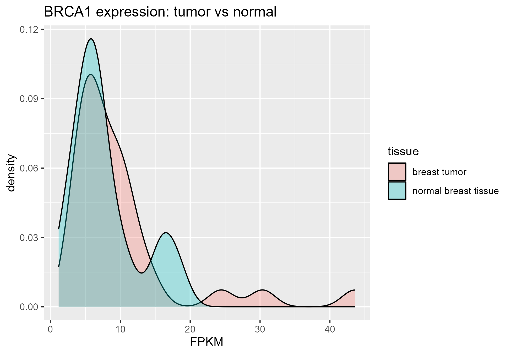
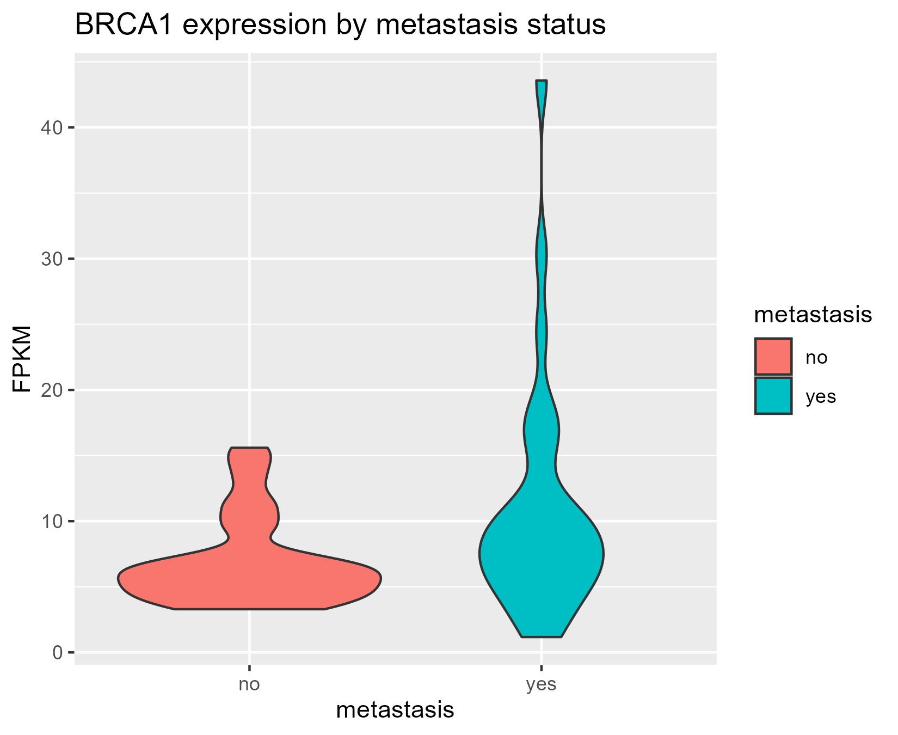
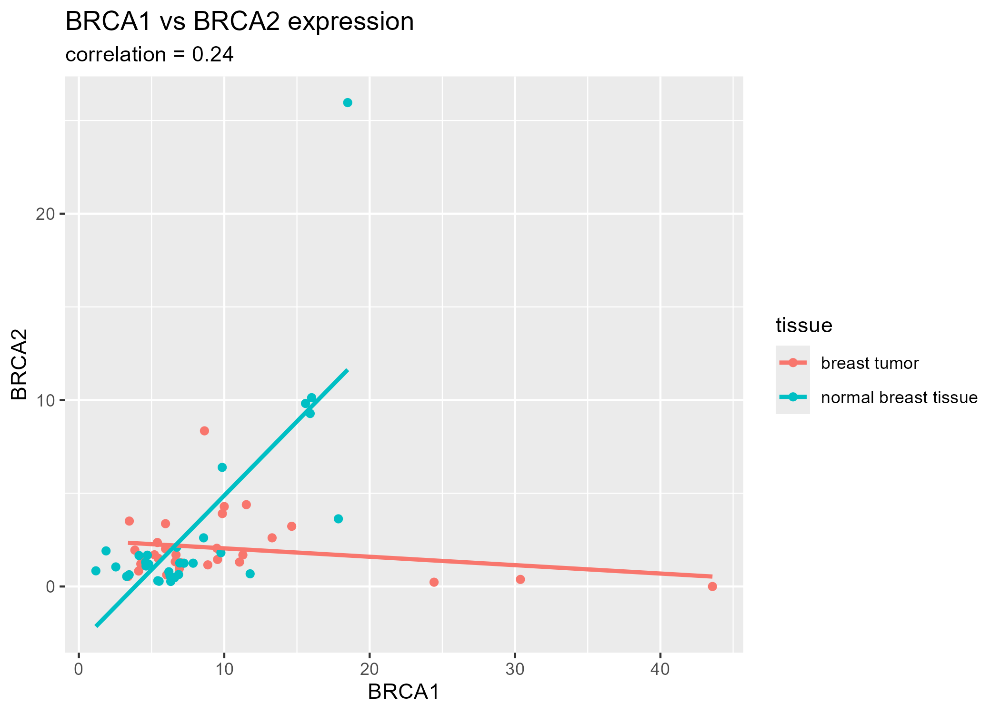
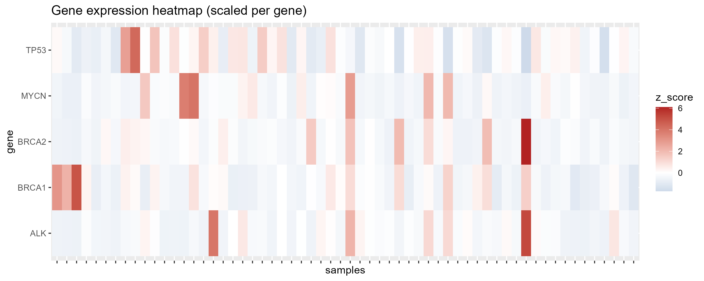

# Data Wrangling and Exploratory Visualisation of Breast Cancer Gene Expression (GSE183947)

**Question:** Does the expression of the breast cancer–associated genes *BRCA1* and *BRCA2* differ between tumour and normal breast tissue, and can this be shown clearly and correctly?

This project takes real public RNA-seq data from NCBI GEO, cleans and reshapes it into a tidy format, joins it with clinical metadata and builds clear exploratory visualisations in R.

## Dataset

- **Source:** NCBI GEO, accession [GSE183947](https://www.ncbi.nlm.nih.gov/geo/query/acc.cgi?acc=GSE183947)
- **Samples:** 60 breast tissue samples: 30 tumour and 30 normal
- **Data type:** FPKM-normalised gene expression, with metadata on tissue type and metastasis status

## Methods

1. **Data retrieval:** downloaded the expression matrix and sample metadata directly from GEO using `GEOquery`, so the project runs on any machine
2. **Data wrangling:** cleaned sample labels, extracted tissue and metastasis information, reshaped the matrix from wide to long ("tidy") format and joined it with the metadata using `dplyr` and `tidyr`
3. **Exploratory visualisation:** built density, violin, scatter and heatmap plots with `ggplot2`
4. **Scaling:** converted expression to per-gene z-scores so that genes with very different expression levels can be compared on one colour scale

## Results

**BRCA1 in tumour vs normal tissue.** Tumour samples show more high-expression values than normal tissue, but the two groups overlap considerably.



**BRCA1 by metastasis status.** Expression is higher and more variable in metastasis-positive samples. Because metastasis status is mainly recorded for tumour samples, this pattern largely mirrors the tumour/normal difference.



**BRCA1 vs BRCA2.** The two genes show only a weak overall correlation (Pearson r = 0.24, Spearman r = 0.31), with a clearer positive trend in normal tissue than in tumour tissue.



**Multi-gene comparison.** Per-gene z-scores allow *BRCA1*, *BRCA2*, *TP53*, *ALK* and *MYCN* to be compared side by side.



**Conclusion.** *BRCA1* tends to be modestly higher in tumour tissue, with substantial overlap between groups. These are exploratory patterns, not statistically tested results; formal differential expression analysis is demonstrated in my [DESeq2 project](https://github.com/Sayali-k28/DSeq2_project).

## Files

| File | Description |
|---|---|
| `fetch_data.R` | Downloads the GSE183947 expression matrix from GEO |
| `data_wrangling.R` | Cleans metadata, reshapes data and saves a tidy table (`data/dat_long.csv`) |
| `exploratory_visualization.R` | Generates the four plots |

## How to run

```r
if (!require("BiocManager", quietly = TRUE)) install.packages("BiocManager")
BiocManager::install("GEOquery")
install.packages(c("tidyverse", "R.utils"))

source("fetch_data.R")                 # downloads the data
source("data_wrangling.R")             # cleans and reshapes it
source("exploratory_visualization.R")  # makes the plots
```

## Skills demonstrated

Retrieving public data from NCBI GEO · metadata cleaning · tidy data principles (wide-to-long reshaping, joins) · exploratory data analysis · data visualisation with ggplot2 · data scaling (z-scores)
